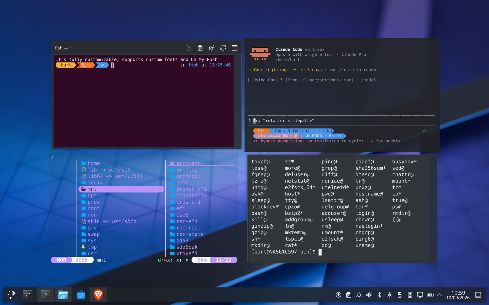
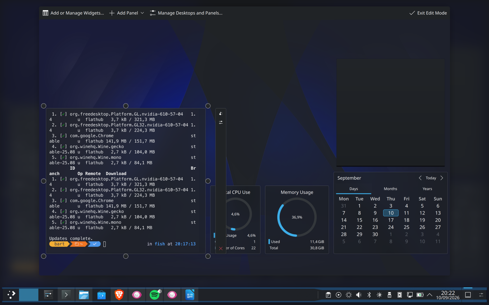
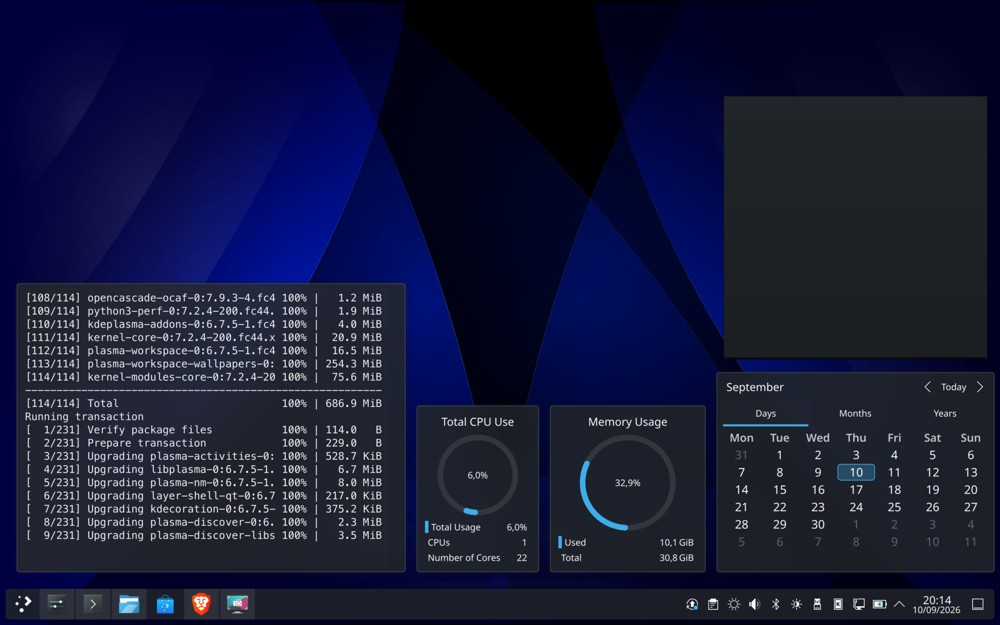
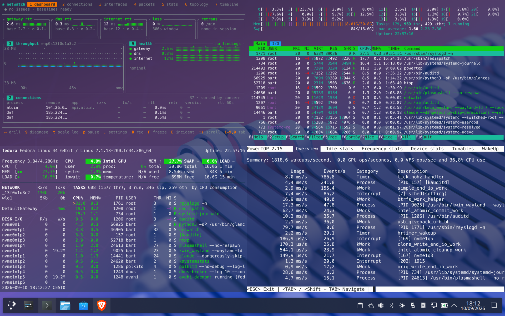
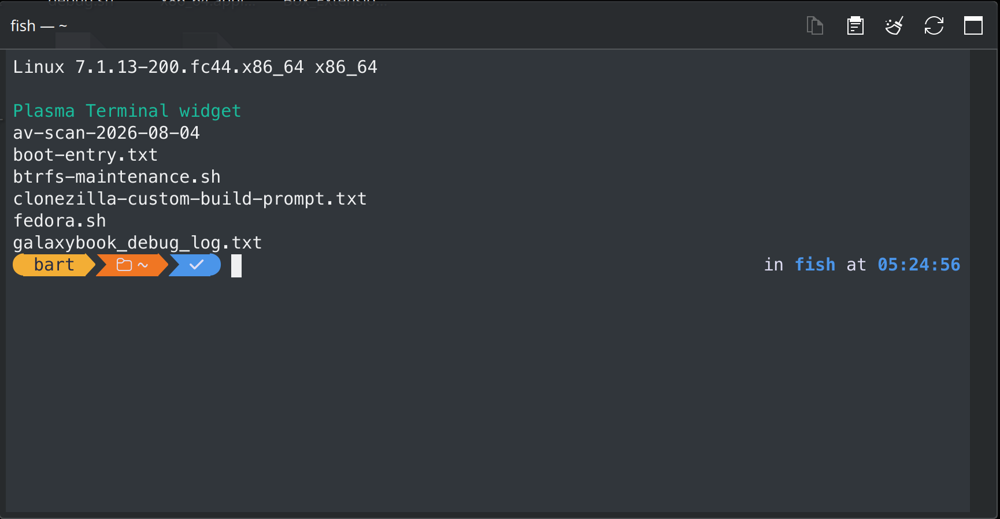

# Plasma Terminal Widget

A terminal emulator that lives on the KDE Plasma 6 desktop as an ordinary
widget. Drag it, resize it, put it behind your icons, give it the colours and
font you already use — it behaves like the rest of your desktop, because it is
drawn by the shell itself.



## Build and install

### Dependencies

Install these first. The build needs CMake 3.20 or newer, a C++ compiler,
Qt 6.5 or newer (Core, Gui, Qml, Quick, Widgets and Core5Compat) and the KDE
Frameworks 6 libraries KCoreAddons and KPty, and fails without them.

**Fedora**

```bash
sudo dnf install cmake gcc-c++ qt6-qtbase-devel qt6-qtdeclarative-devel \
    qt6-qt5compat-devel kf6-kcoreaddons-devel kf6-kpty-devel
```

**Debian / Ubuntu** — Debian 13 or later, Ubuntu 26.04 or later. Debian 12 and
Ubuntu 24.04 ship Qt 6.4 and no KDE Frameworks 6 build of KPty.

```bash
sudo apt install cmake build-essential qt6-base-dev qt6-declarative-dev \
    qt6-5compat-dev libkf6coreaddons-dev libkf6pty-dev \
    qml6-module-org-kde-notifications
```

The build does not need the last package: it is the QML module for desktop
notifications, which the terminal bell's *Notification* mode uses. A full
Plasma desktop already has it; a minimal install may not. On Fedora and Arch
it is part of the KNotifications package, which Plasma itself depends on.

**Arch**

```bash
sudo pacman -S --needed base-devel cmake qt6-base qt6-declarative qt6-5compat \
    kcoreaddons kpty
```

`install.sh` also calls `kpackagetool6`, which comes with Plasma 6 itself, so
it is already there on any machine that can run the widget. If it is missing,
it lives in `kpackagetool6` on Debian and Ubuntu and in `kpackage` on Arch.

### Build

```bash
git clone https://github.com/Cir0cuit/plasma-terminal-widget.git
cd plasma-terminal-widget
./install.sh
```

`install.sh` configures and builds the project, then installs both halves: the
QML module with `sudo cmake --install` (it has to land on Qt's import path) and
the applet with `kpackagetool6` for the current user only. It will ask for your
password for the first of those. Run it as yourself, not with `sudo`: the
applet goes to the user who runs it. Where sudo is not installed, it uses
`su`, which asks for root's password instead.

Restart plasmashell afterwards so it picks up the new QML module:

```bash
systemctl --user restart plasma-plasmashell.service
```

If that command fails because Plasma does not run as a systemd user service on
your system, log out and back in instead.

Then add it from the desktop context menu: *Add Widgets… → Terminal*. To remove
everything again, run `./uninstall.sh` — take the widgets off the desktop
first, or the shell will show an empty placeholder until it is restarted.

### Updating

Updating keeps your widgets and all their settings. From the folder where you
ran `git clone` (usually your home folder), run:

```bash
cd plasma-terminal-widget
git pull && ./update.sh
```

`git pull` downloads the new version, including `update.sh` itself if your
copy is from 1.0, which did not have it. `./update.sh` builds the new version
and installs both halves the way `install.sh` does, so it asks for your
password once. Then it shows what changed and offers to restart plasmashell:
Plasma keeps running the old version until it restarts, and restarting ends
the shells running in terminal widgets, so it asks first.
`./update.sh --restart` and `./update.sh --no-restart` answer in advance.

Before it builds, `update.sh` says what it found: `Updating 1.0.0 -> 1.1.0.`
for an ordinary update, that only the engine is old when *Get New Widgets* has
already updated the widget, or that no engine is installed yet. The changes it
lists afterwards start from the older of the two halves, so an earlier update
from *Get New Widgets* does not hide them.

If the widget package or the engine installed now is newer than the copy in
the folder, `update.sh` and `install.sh` stop and change nothing, so an old
copy never puts an older version back; run `git pull` first. Copies from 1.0
do not check this, so in one of those, run `git pull` before anything else.
To go back to an older version on purpose, run `./uninstall.sh` and then
`./update.sh` (`./install.sh` for 1.0) in a copy of that version, and restart
Plasma only after both. Leave the widgets on the desktop: they keep their
settings.

**Widget updated from Get New Widgets.** *Get New Widgets* and *Discover*
update only the widget package; the engine changes only when it is rebuilt.
Plasma keeps running the old widget until it restarts, and neither of them
tells you to restart it: do that after such an update (see below). If the
engine is then older than the widget, the widget keeps working, and its
settings pages say the engine is outdated and name what on each page waits
for it, such as font styles or the terminal bell. `git pull && ./update.sh`,
as above, then rebuilds the engine and shows what changed.

**No folder, or no engine yet.** If the folder is gone, or the widget came
from *Get New Widgets* and the engine was never built, install the
dependencies above, run the first two commands under *Build*, then
`./update.sh`.

**Without git.** On GitHub, choose *Code → Download ZIP*, unpack it and run
`./update.sh` in the unpacked folder.

If `git pull` stops with an error:

* **`Your local changes to the following files would be overwritten`** —
  files in the folder were edited. Set the edits aside with `git stash`, then
  run `git pull && ./update.sh` again.
* **`not a git repository`** — the terminal is not in the folder that
  `git clone` created, or the copy was downloaded rather than cloned; for
  that, see *Without git*.

**Restarting plasmashell yourself:**

```bash
systemctl --user restart plasma-plasmashell.service
```

If that command fails because Plasma does not run as a systemd user service on
your system, log out and back in instead.

[CHANGELOG.md](CHANGELOG.md) lists what each version changed, which halves it
touched, and anything an update needs beyond these steps.

## How it works

The terminal view is a `QQuickPaintedItem`, so it is a first-class item in
plasmashell's own scene graph. That has a few practical consequences:

* it moves, resizes and clips with the applet, and stacks correctly against
  other widgets;
* it paints at the screen's device pixel ratio, so text stays crisp on HiDPI
  displays;
* it uses the ordinary Qt clipboard and the ordinary Qt input path, so
  selection, copy, paste and keyboard handling work the way they do in any
  other Qt application.

There is no helper process, no embedded window and no second compositor: the
widget owns a pty directly and paints the characters itself.

|  |  |
| :-- | :-- |
| Plasma's edit mode treats it like any other widget: resize handles, the widget toolbar, and its own configuration dialog. | It sits on the desktop next to the stock system-monitor and calendar widgets, under the same wallpaper and the same stacking rules. |

## Architecture

```
package/                 the plasmoid (QML)  ->  ~/.local/share/plasma/plasmoids/
  contents/ui/main.qml         PlasmoidItem, desktop + panel representations
  contents/ui/TerminalPane.qml header, terminal, scrollbar, context menu
  contents/ui/Config*.qml      the three settings pages
  contents/ui/EngineStatus.qml settings notice: engine missing or outdated
  contents/ui/EngineInfo.qml   the settings pages' only import of the engine
  contents/ui/version.js       the oldest engine this package works with
src/                     the QML module (C++) ->  <Qt QML import path>/io/github/cir0cuit/plasmaterminal/core/
  terminalview.*               QQuickItem: input, focus, clipboard, zoom, drops
  terminalsessionex.*          the shell session: env, scrollback, resets
  terminalinfo.*               fonts, colour schemes, Konsole profile lookup
  color-schemes/               8 extra schemes on top of the 13 built in
lib/                     terminal core, vendored (GPL-2.0-or-later)
test/                    a standalone host for the terminal item, plus helpers
  update-routes.sh             tests each update path from the previous release
scripts/common.sh        what install.sh, update.sh and uninstall.sh share
install.sh / update.sh / uninstall.sh
```

The QML module has to live on Qt's own import path because that is where
plasmashell resolves imports from; the applet package is per-user. Where that
import path is depends on the distribution — `/usr/lib64/qt6/qml` on Fedora,
`/usr/lib/x86_64-linux-gnu/qt6/qml` on Debian and Ubuntu, `/usr/lib/qt6/qml` on
Arch — so the build asks Qt itself rather than guessing, and `uninstall.sh`
reads the path back out of the install manifest. That split is also why the
widget cannot be installed from *Get New Widgets* alone: that route unpacks a
QML archive into your home directory, and nothing it writes is on plasmashell's
import path. If the module is missing, the widget and its settings pages say
so and point here rather than failing with an error box.

### Vendored code and local modifications

`lib/` is the terminal core from KDE's
[qmlkonsole](https://invent.kde.org/utilities/qmlkonsole) 26.08.0 — a Qt6 QML
terminal built on QMLTermWidget and, underneath that, Konsole's VT102
emulation. All the hard work of terminal emulation is theirs; this project
provides the Plasma widget around it.

As required by the GPL, the changes made to that vendored code are listed here
and marked `(patched)` at each site:

1. `TerminalSession.cpp` — `TERM` is passed to the child through the session
   environment instead of being set on the hosting process.
2. `Session.cpp` — the `COLORFGBG` hint is appended to a copy of the
   environment at launch, so repeated starts do not accumulate copies of it,
   and says dark or light according to the view's actual background colour.
   The session's bell is connected to the view, which nothing else did, a
   shell killed by a signal reports that it finished, and only an empty
   program falls back to `$SHELL` or `/bin/sh`, so a missing path fails to
   start instead of running another shell.
3. `TerminalSession.h` — added a `konsoleSession()` accessor, so scrollback and
   emulation resets can be driven from QML.
4. `BlockArray.cpp` — the four block offsets passed to `fseek()` are computed
   as `long` rather than multiplied as `int` and widened afterwards, which
   overflows above a 2 GiB history file. Found by CodeQL; the code is an
   unused history backend, so nothing in the widget can reach it.
5. `TerminalDisplay.cpp`, `TerminalDisplay.h` — `drawCharacters()` no longer
   calls `setBold(false)`, which reset a Light or Medium base font to Regular
   for italic and underlined text, and raises bold text to Bold only from a
   lighter base, since Qt 6 already counts SemiBold as bold. The antialiasing
   switch belongs to each view instead of being shared by all of them, takes
   effect at once, and can be turned back on. The cursor is repainted across
   its whole row, because cells sit at fractional positions; only the focused
   view blinks, and the blink timer always gets its interval. Changing the
   bold or full-height cursor setting repaints at once, the normal cursor
   covers the glyph area below the line spacing instead of reaching into the
   next row, and the column count is rounded down so a partial last column
   is never clipped. `drawContents()` maps a repainted area back to rows with
   the same rounded line height the layout uses; the unrounded height picked
   a row further down, which blanked lines on the lower rows. A zero cursor
   flash time means no blinking instead of a 0 ms timer.

## Settings

**Appearance** — follow your Konsole profile font or pick a family, style
(Light, Medium, Italic, … — any weight or italic the family is installed in) and size,
line spacing, colour scheme (21 ship with the widget, and any schemes Konsole
already has installed are listed too) with a live preview swatch, widget
background (Plasma frame / translucent / none), terminal opacity, padding,
cursor shape, blinking cursor, full-height cursor, bold font for bold text, glyph
antialiasing, title-and-toolbar strip, scrollbar and scrollbar auto-hide.

**Shell** — program and arguments, working directory, a command to run at
startup, start-on-load, scrollback lines or unlimited, flow control, and extra
environment variables.

**Behavior** — focus on click, copy on select, middle-click paste, Ctrl+wheel
zoom, word characters for double-click selection, built-in clipboard
shortcuts, read-only mode, terminal bell, and what to do when the shell exits
(new session / restart button / leave the last screen).

Leaving the font and colour scheme unset means *follow my default Konsole
profile*, so the widget matches the terminal you already use — font style
included.



## Keys and mouse

| Input | Action |
| --- | --- |
| Ctrl+Shift+C / Ctrl+Shift+V | copy / paste |
| Ctrl+Shift+`+` / `-` / `0` | zoom in / out / reset |
| Ctrl+wheel | zoom |
| wheel | scroll the scrollback |
| double click | select a word |
| right click | context menu |
| middle click | paste the selection (off by default) |
| drag files onto it | insert their paths, quoted where the shell needs it |

The keyboard shortcuts and Ctrl+wheel zoom are the widget's own, and each can
be turned off under **Behavior** if the program in the terminal wants those
keys instead. Everything else goes straight to the shell.

The optional strip along the top shows the session title and buttons for copy,
paste, clear-and-reset, restart and *Open in Konsole*, which hands the current
working directory to a real Konsole window. The same entries — plus
*Configure Terminal…* — are on the right-click menu, and they appear again in
Plasma's own widget menu.



## Notes

* Colour schemes are listed and previewed by name; the description field in
  scheme files is not shown.
* The context menu is drawn inside the shell's window rather than as a separate
  popup window, which is how QtQuick Controls popups behave inside a plasmoid.
* Tabs and search-in-scrollback are not implemented.

## Testing

`test/harness.qml` runs the terminal item on its own, outside plasmashell:

```bash
./build/pt-harness -I build/qml test/harness.qml
```

It starts a shell, types through the real key path, resizes the view and
reports what it observed. Qt on Fedora sends messages to the journal when
stderr is not a tty, so read them with `journalctl --user -t pt-harness`.

`test/pointer.sh` moves the pointer to an exact position under KWin, which the
interactive tests need because ydotool emits accelerated relative motion.

`test/update-routes.sh` tests every way to get from the previous release to the
working tree: with `git pull` and `./update.sh`, after a store update of the
widget package, from the store package alone, over a newer installation,
twice in a row, and out again with `./uninstall.sh`. Each route runs in a fresh
rootless podman container on Fedora, Debian, Ubuntu and Arch. The widget itself
runs in a hidden nested Plasma session, on the old engine, the new one and
none. It installs nothing on the machine it runs on and shows no window, but
it keeps its container images (several gigabytes:
`localhost/ptw-update-routes-*` and the distribution images they are built
from) and its compiler caches (the podman volumes
`ptw-update-routes-ccache-*`) between runs; `podman rmi` and
`podman volume rm` remove them. Its header lists the tools it needs.

## How this was built

This widget was written with an AI coding agent — Claude Code — doing the
implementation, under human direction and review. The vendored terminal core is
upstream KDE code; the C++ QML module, the plasmoid and the settings pages are
agent-written.

That is a statement of fact rather than an excuse, but it comes with limits
worth stating plainly, so here is what has actually been run.

It has been built, installed and used on four distributions:

* **Fedora 44** — Plasma 6.7.5 on Wayland, Qt 6.11.2, GCC 16.2.
* **Debian** — Plasma 6.7.4 on Wayland, with the module landing on Debian's
  multiarch QML path rather than Fedora's `lib64`.
* **Arch** — Plasma 6.6.5 on Wayland, Qt 6.11.1, GCC 16.1: an older Plasma and
  a newer compiler than this code was written against.
* **Ubuntu** — with the same apt command as Debian.

On each of them the dependency line installs, the build is clean, the module
lands on that distribution's own import path, and plasmashell loads it with the
widget running a live shell. The store package was installed from *Get New
Widgets* on more than one of them, and the missing-engine placeholder behaves
as designed.

Fedora is where the detail work was checked: sessions start and stop, input and
clipboard go through the real event path, teardown leaves no stray shell
processes, and the widget survives being moved, resized and reconfigured on a
live desktop.

For 1.1.0, `test/update-routes.sh` ran every update route from 1.0 on
Fedora 45, Debian 13, Ubuntu 26.04 and Arch, and ran the widget on
Plasma 6.8.2 with the 1.0 engine, the 1.1.0 engine and none.

What has not been tried is X11, fractional or 1× scaling, multiple monitors,
and most of the settings in combination with one another. If it misbehaves, the
useful bug report is the one that says what your setup was.

## Contributing

Contributions are welcome. Anything that meets a high quality bar will be
considered and, most likely, merged — a clear description of the problem, a
change that does one thing, and evidence that you ran it.

AI-assisted contributions are equally welcome, on one condition: a human has to
have verified them. Either you understand what the agent produced well enough
to defend it line by line, or you have tested it thoroughly enough to know it
works. Both is better.

What will not be accepted is unverified output submitted on the assumption that
someone else will check it: patches that break existing behaviour, that make
the widget unusable, or that fix bugs which do not exist. Reviewing that costs
more than writing it did, and repeatedly submitting it is grounds for a ban.

If you are unsure whether an idea fits, open an issue before writing the code.

Releases follow the checklist in [doc/releasing.md](doc/releasing.md).

## Credits

The terminal emulation comes from Konsole by way of QMLTermWidget and
qmlkonsole — thanks to Lars Doelle, Robert Knight, Dmitry Zagnoyko, Jonah
Brüchert and everyone else who has worked on them.

## Licence

GPL-2.0-or-later, following the vendored terminal core. See `LICENSE`.
